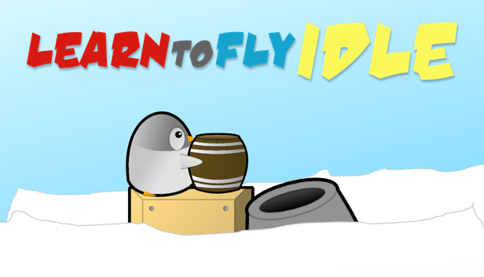

# Learn to Fly Idle: source code

ActionScript 3 source for Learn to Fly Idle, version 1.1.103, from the Flash project last saved in 2018. Most of the game code is in separate ActionScript classes. Frame scripts on the main timeline and in library movie clips handle startup and parts of the interface and animation.

## Mechanics

The [mechanics guide](docs/mechanics.md) covers how the cannon fires, how hits deal damage and earn cash, and how to unlock targets and research upgrades. It also explains what counts as a timed clear.

## Artwork renders

[Preview](docs/art-renders/preview.png) · [Asset manifest](docs/art-renders/manifest.csv). The full pack contains transparent 256 × 256 and 1024 × 1024 PNGs in `learn-to-fly-idle-art-renders.zip` for [Releases](../../releases).

## Run rules

Research caps at level 10. A later qualifying kill can overwrite a stored clear time under 7,000 seconds with a slower time.

## What's here

This release is for reading the source. The original art files, sound and Flash project file aren't included.

1. `src/`: the game's classes.
2. `scripts/`: the code that sat on timeline frames inside the Flash project file, one file per timeline. Each block starts with a comment saying which layer and frame it's on.
3. `framework/lbg/`: Light Bringer Games' shared Flash library, which the game uses for logging, audio and more.

Not included, since they aren't ours to relicense: `PixelPerfectCollisionDetection` from freeactionscript.com, and Adobe's Flash components.

Third-party framework code keeps its original terms: `CollisionDetection.as` (Grant Skinner, MIT), `MouseWheelTrap.as` (spikything.com, MIT), `Easing.as` (Robert Penner, BSD) and `BigInt.as` (Leemon Baird, ActionScript port by Ian Peters, public domain).

## License

The [LBG-NCNC License v1.0](LICENSE.md) covers Light Bringer Games' source code in this repository.

You can read, use, change, and share the code for noncommercial purposes, including by forking it on GitHub. When sharing, credit Light Bringer Games and keep the license and copyright notices. Get written permission before distributing or hosting a product based on the code that competes with or undercuts a Light Bringer Games product or service, even if it's free. The full license governs.

Light Bringer Games reserves its rights in the game's name, art, and sound. Third-party files have their own licenses.
